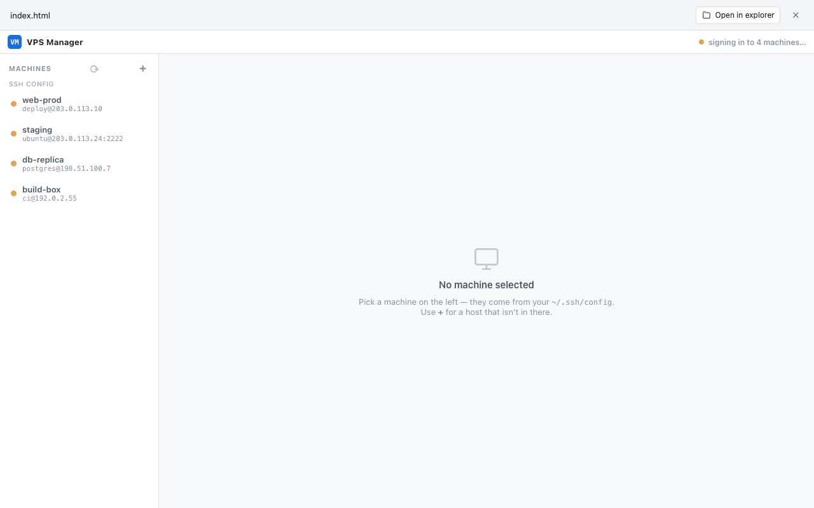

# VPS Manager

Manage every SSH host you can reach from one page. The machine list builds
itself from `~/.ssh/config` (with `Include`s and `Host *` defaults) and
`known_hosts`, so there's nothing to type in. On load, each machine gets a
real login and shows its OS and uptime, or the SSH error.

- File browser: copy, move, rename, delete, upload, download and search.
- Preview pane using fused-render's normal file templates.
- Interactive terminal (xterm.js over an SSH PTY).
- `ProxyJump` works. `ProxyCommand` isn't supported.

A small localhost daemon (`vps.py`) holds the SSH connections, guarded by a
per-daemon token. It exits after 30 minutes idle, and the page restarts it when
needed. paramiko is the only dependency, and fused-render installs it from
`pyproject.toml` (`install.py` is only for other interpreters).

> Hosts you add by hand are saved to `machines.json` beside `vps.py`.
> Prefer key files: a stored password is kept there in plain text.
